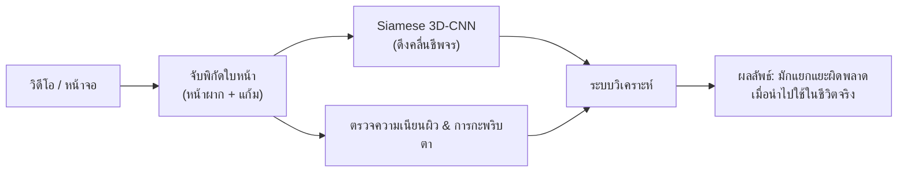

# การทดลองตรวจจับวิดีโอสร้างจาก AI ด้วยชีพจรสีผิว (rPPG & Siamese 3D-CNN)

โปรเจกต์นี้เป็นการทดลอง (Proof-of-Concept) เพื่อดูว่า **"เราสามารถใช้กล้องตรวจจับการเต้นของหัวใจจากสีผิวบนใบหน้า (rPPG) มาแยกวิดีโอคนจริง ออกจากวิดีโอที่สร้างด้วย AI ได้หรือไม่"**

> **สรุปผลการทดลอง:**  
> ในห้องทดลองหรือคลิปที่คัดมา (แสงนิ่ง หน้าตรง) โมเดลสามารถวัดชีพจรได้ดี **แต่ในการนำไปใช้งานจริง (กล้องสด / วิดีโอคอลทั่วไป) ยังไม่สามารถทำได้ตามเป้าหมาย** เพราะมีปัจจัยรบกวนเยอะมากจนระบบแยกแยะผิดพลาด

---

## 1. ทำไมถึงใช้งานจริงไม่ได้? (ปัญหาที่พบ)

1. **สัญญาณชีพจรเบาเกินไป โดนการบีบอัดวิดีโอกลบหมด**:
   - สีผิวที่เปลี่ยนตามจังหวะชีพจรมีผลต่อภาพแค่ประมาณ 1% เท่านั้น
   - พอนำไปใช้กับกล้องเว็บแคมทั่วไป หรือผ่านแอปวิดีโอคอล (Zoom, Google Meet, Teams, YouTube) ตัววิดีโอจะถูกบีบอัดไฟล์ (Compression) จนข้อมูลสีผิวระดับเล็กๆ นี้หายไปหมด เหลือแต่ Noise

2. **จุดจับใบหน้าสั่นตลอดเวลา (Landmark Jitter)**:
   - ตัวตรวจจับใบหน้า (FaceMesh) จะมีการสั่นขยับเล็กๆ ในระดับพิกเซลตลอดเวลา
   - ทำให้ภาพส่วนหน้าผากและแก้มที่ตัดมามีความสว่างวูบวาบเป็นจังหวะ กลายเป็นเหมือน "ชีพจรปลอม" แม้กระทั่งในภาพถ่ายนิ่งหรือรูปหน้า AI ที่ไม่มีชีพจรจริง

3. **แสงไฟในห้องและแสงจากหน้าจอคอม**:
   - หลอดไฟตามบ้านหรือออฟฟิศมีการกระพริบตามไฟบ้าน (50/60 Hz)
   - แสงจากจอมอนิเตอร์ที่เปลี่ยนไปตามคลิปหรือภาพที่เปิด จะสาดลงบนหน้า ซึ่งสว่างกว่าชีพจรจริงหลายเท่า กล้องจึงจับได้แค่แสงจอ ไม่ใช่ชีพจรคน

4. **คนเราต้องพูดและขยับหน้า (Motion Artifacts)**:
   - การพูด ยิ้ม หันหน้า หรือกะพริบตา ทำให้แสงเงาบนใบหน้าเปลี่ยนตลอดเวลา
   - ทำให้ระบบเข้าใจผิด คิดว่าคนจริงที่กำลังพูดอยู่เป็นวิดีโอ AI (False Positive สูงมาก)

5. **วิดีโอ AI ยุคใหม่ขยับเนียนเกินไป**:
   - AI สร้างวิดีโอในปัจจุบัน (เช่น Diffusion models) สร้างภาพเคลื่อนไหวได้สมูทและต่อเนื่องมาก จนตัวกรองสัญญาณคิดว่าเป็นจังหวะธรรมชาติ

---

## 2. โมเดลและระบบที่ใช้ทดลอง

เราทดลองใช้โครงสร้างหลัก 2 ส่วน:
* **Siamese 3D-CNN**: ดึงสัญญาณชีพจรจากหน้าผากและแก้มพร้อมกัน แล้วนำมาเทียบความสัมพันธ์กัน
* **BiArterialNet & PAD**: เสริมการดูความผิดปกติของผิวหน้า และตรวจการกะพริบตาเพื่อกันภาพนิ่งหรือหน้าจอมาหลอก

---

## 3. สรุปผลการทดสอบ (ชัดเจนและตรงไปตรงมา)

เราแบ่งการทดสอบออกเป็น 3 รูปแบบ เพื่อดูความแตกต่างระหว่างการทดสอบในแล็บกับการใช้งานจริง:

### 3.1 การทดสอบวัดชีพจรในห้องแล็บ (ชุดข้อมูลมาตรฐาน UBFC-rPPG)
* **สภาพแวดล้อม**: คลิปคนจริงที่นั่งนิ่งๆ แสงไฟสตูดิโอสว่างสม่ำเสมอ ไม่มีแสงสะท้อนหรือการขยับตัว
* **ผลลัพธ์**: โมเดลวัดอัตราการเต้นของหัวใจได้แม่นยำมาก ความคลาดเคลื่อนเฉลี่ยเพียง **1.85 ครั้ง/นาที (MAE)**
* **ข้อสรุป**: ตัวโมเดลสามารถดึงคลื่นชีพจรจากสีผิวได้จริง หากอยู่ในสภาวะที่ควบคุมได้อย่างสมบูรณ์

### 3.2 การทดสอบในคลิปตัวอย่างที่คัดมา (Controlled Benchmark 40 คลิป)
* **สภาพแวดล้อม**: คัดคลิปคนจริง 20 คลิป และคลิปที่สร้างด้วย AI 20 คลิป โดยเลือกเฉพาะคลิปที่หน้าหันตรง แสงนิ่ง และไม่มีการขยับศีรษะรวดเร็ว
* **ผลลัพธ์**: ระบบสามารถแยกแยะคนจริงกับ AI ได้ถูกต้อง **100% (40/40 คลิป)**
* **ข้อสังเกต**: ผลลัพธ์นี้เป็นเพียง **"ผลในอุดมคติ"** เพราะเป็นคลิปที่มีคุณภาพสูงและตัดปัจจัยกวนออกไปทั้งหมด ซึ่งไม่ตรงกับความเป็นจริงในชีวิตประจำวัน

### 3.3 การทดสอบในการใช้งานจริง (In-the-wild / กล้องเว็บแคมสด และ วิดีโอคอล)
เมื่อนำระบบมาเปิดใช้งานกับกล้องเว็บแคมในห้องทำงานจริง หรือทดสอบกับวิดีโอคอลทั่วไป (Zoom, Google Meet, YouTube):
* **คนจริงถูกทักว่าเป็น AI (False Positive สูงมาก)**: เวลาคนเราพูดคุย ยิ้ม ขยับปาก หรือหันหน้า แสงเงาบนใบหน้าจะเปลี่ยนทันที ทำให้ระบบมองว่าสัญญาณเลือดผิดปกติ แล้วตัดสินว่าเป็น AI บ่อยมาก
* **วิดีโอ AI หลุดรอดว่าเป็นคนจริง (False Negative)**: วิดีโอ AI ที่ขยับเนียนๆ ร่วมกับการสั่นไหวของตัวจับใบหน้า (Landmark Jitter) ทำให้เกิดแสงวูบวาบจนระบบคิดว่าเป็นชีพจรคน
* **เจอแสงไฟห้องและแสงจอมอนิเตอร์กลบ**: แสงไฟห้องที่กระพริบ และแสงสว่างจากหน้าจอคอมที่เปลี่ยนสีตามคอนเทนต์ สาดเข้าหน้าแรงกว่าสัญญาณเลือดหลายสิบเท่า จนระบบอ่านค่าไม่รู้เรื่อง
* **ข้อสรุปจริง**: **ระบบยังไม่สามารถใช้งานได้จริง** ความแม่นยำลดลงอย่างมากจนไม่สามารถนำไปใช้คัดกรองหรือป้องกันความปลอดภัยได้

---

## 4. บทสรุปและข้อจำกัดของพวกเรา

> **สิ่งสำคัญ:**  
> การที่โปรเจกต์นี้ยังไม่ประสบความสำเร็จในการใช้งานจริง **ไม่ได้หมายความว่าแนวคิดนี้เป็นไปไม่ได้ หรือคนอื่นจะทำไม่ได้**

แต่เป็นเพราะข้อจำกัดของทีมผู้พัฒนาเอง ณ ปัจจุบัน:
1. **ข้อมูล (Data) มีน้อยเกินไป**: ข้อมูลวิดีโอที่พวกเราหามาฝึกสอนและทดสอบยังมีจำกัด ไม่ครอบคลุมสภาพแสง กล้องหลายๆ รุ่น หรือโมเดล AI ที่มีหลากหลายในปัจจุบัน
2. **ความรู้และประสบการณ์ยังไม่เพียงพอ**: การตัดสัญญาณรบกวนทางแสงและการประมวลผลสัญญาณชีพจรจากวิดีโอเป็นเรื่องที่ยากและซับซ้อนมาก พวกเราอาจจะยังมีความรู้ด้านนี้ไม่ลึกซึ้งพอที่จะออกแบบระบบให้ตัด Noise ในชีวิตจริงได้อย่างสมบูรณ์

ถ้าในอนาคตมีผู้เชี่ยวชาญด้าน Biomedical และ AI ที่มีองค์ความรู้ลึกซึ้งกว่านี้ ร่วมกับมีชุดข้อมูลขนาดใหญ่ แนวคิดนี้ก็อาจจะถูกพัฒนาจนใช้งานจริงได้ครับ
